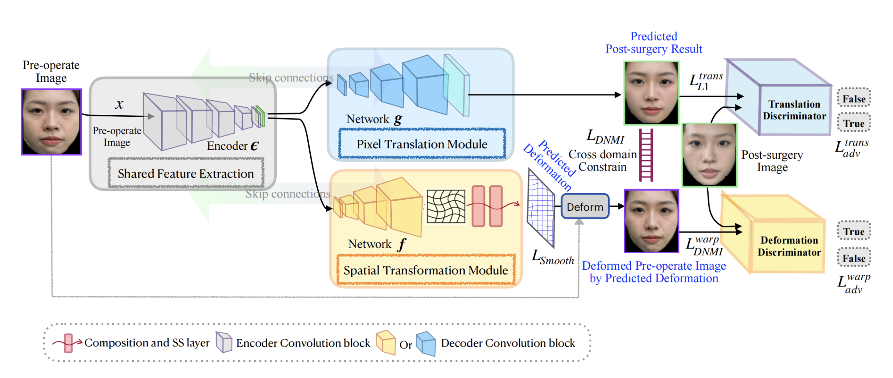
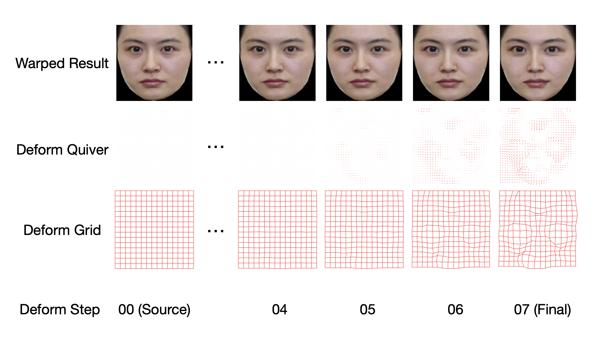

# TraceTrans : Translation and Spatial Tracing for Surgical Prediction

📄 [](https://arxiv.org/abs/2510.22379)

### Model Framework Overview



### Deformation Steps Overview



---

## How to Run

### 1. Installation

```bash
git clone https://github.com/xyluoxy/TraceTrans.git
cd TraceTrans

conda create -n tracetrans python=3.10 -y
conda activate tracetrans
pip install -r requirements.txt
```

TraceTrans uses the PyTorch version of [neurite](https://github.com/adalca/neurite), which is installed from GitHub at a pinned commit (`890ed01`). Later commits rename the APIs used here, so please keep this version.

### 2. Data Preparation

Image paths in the pair list are relative to the directory containing the JSON file:

```
data/
├── pairs.json
├── before/
├── after/
└── gt_warped/
```

```json
{
  "dataset": [
    {
      "idx": 0,
      "before": "before/0.png",
      "after": "after/0.png",
      "gt_warped": "gt_warped/0.png"
    }
  ]
}
```

### 3. Training

```bash
python train.py \
    --exp-name demo \
    --pairlist-path data/train_pairs.json
```

### 4. Testing

```bash
python test.py \
    --exp-name demo \
    --ckpt-path models/demo-epoch99 \
    --pairlist-path data/test_pairs.json \
    --output-path results/demo
```

---

## Citation

```bibtex
@inproceedings{luo2026tracetrans,
  title={TraceTrans: Translation and Spatial Tracing for Surgical Prediction},
  author={Luo, Xiyu and Li, Haodong and Cheng, Xinxing and Zhao, He and Hu, Yang and Song, Xuan and Zhang, Tianyang},
  booktitle={Proceedings of the AAAI Conference on Artificial Intelligence},
  volume={40},
  number={9},
  pages={7698--7706},
  year={2026},
  doi={10.1609/aaai.v40i9.37712}
}
```

---

## License

This project is licensed under the **Creative Commons Attribution-NonCommercial 4.0 International (CC‑BY‑NC 4.0)** license.
You may copy, modify, and redistribute the code for **non-commercial purposes**, with proper attribution to the original authors.

**Academic and research use is explicitly welcomed**. You are encouraged to use this code for experiments, publications, or educational purposes, provided that any resulting work gives appropriate credit.

Commercial use, redistribution, or incorporation into a commercial product without explicit permission from the copyright/patent holder is **prohibited**.

Full license text: [CC BY‑NC 4.0 Legal Code](https://creativecommons.org/licenses/by-nc/4.0/legalcode)
